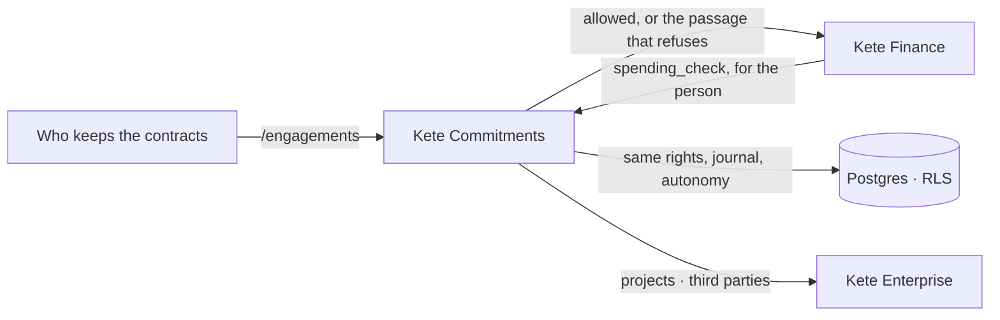

# Kete Commitments

What the company signed — with its clients, its suppliers and its funders — and what each contract
requires: obligations and their dates, retentions and bonds to recover, and a funder's **rules of
spending**, checked before money is committed. One of the four apps behind the center, Kete
Enterprise (doctrine D-048).



Every obligation, retention, bond and rule carries **the passage of the contract** it comes from,
as it is written: a refusal cites it, a reminder quotes it.

## Run locally

```bash
pnpm install
cp .env.example .env
pnpm db:migrate
pnpm dev
pnpm demo              # http://localhost:3431 — three contracts, a funder's rules, in a throwaway schema
```

`pnpm demo` opens as the owner; `/manager` and `/staff` open as the roles of the trade. It runs
without a center: projects are named by who writes the contract.

## Test

```bash
pnpm test
pnpm typecheck
```

## Settings

| Variable               | What it sets                                           |
| ---------------------- | ------------------------------------------------------ |
| `ENTERPRISE_API_URL`   | The center: projects and third parties                 |
| `COMMITMENTS_CURRENCY` | The currency of contracts (ISO 4217); `XOF` by default |

Other apps reach `spending_check` at `/api/v1/capabilities/spending_check` with the person's
token; Kete Finance names this app's address in its `COMMITMENTS_API_URL`.
