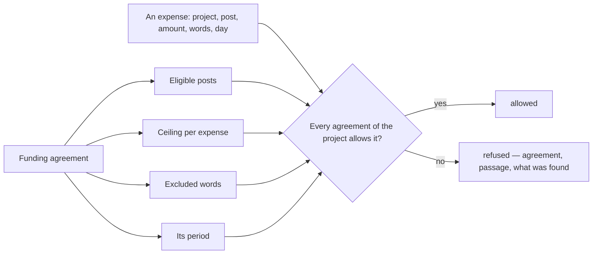

# Spec 001 — Commitments

Step **I1** of the plan (Kete Enterprise's roadmap): contracts, their obligations and dates,
retentions and bonds, and a funder's agreement as **rules of spending** — whose proof is « A
funder's clause refuses a purchase in Kete Finance ».

## Why

A funder pays for panels and labour, never for a vehicle; above 1 500 000 F CFA it wants to be
asked first; after the agreement's last day it pays nothing. These rules are in a PDF nobody opens
when the purchase is asked — and are found by the auditor, when the expense is declared
ineligible and must be paid back from the company's own money.

## What it gives

- **Contracts** with a client, a supplier or a funder: reference, subject, party (the center's),
  project (the center's, which she must see), amount, dates.
- **Obligations** with their day, who owes them (us or them) and their passage; what is due within
  30 days; met.
- **Retentions and bonds** with their release day and passage; those to recover.
- **A funder's rules of spending**: eligible posts, a ceiling per expense, excluded words, the
  agreement's period — each with its passage.
- **`spending_check`**: an app asks, for a person, whether a project's funders allow an expense;
  the answer is allowed, or each refusal with its agreement, its passage and what was found. Over
  the API at `/api/v1/capabilities/spending_check`.
- Three permissions: read, keep the contracts, check an expense.
- Screens under `/engagements`: what is due, what to recover, the contracts; a contract with its
  rules, obligations, retentions and bonds.

## What stays for later

- A contract read from its PDF into obligations and rules, each passage cited by the reading
  (kete-core step E4).
- A ceiling over the whole agreement or per post (needs Kete Finance's amounts).
- Reminders before an obligation's day, on WhatsApp and Telegram.
- A retention recovered telling Kete Finance it is money in.

## Proof

- `tests/commitments.test.ts` (10): the rules read — allowed, and each refusal with its passage;
  written on the project the center shows; **a vehicle is refused with « Art. 5.4 »**, for the
  person, and over the HTTP API an expense above the ceiling is refused; who has no role may not
  ask; obligations due, retentions and bonds to recover; RLS; the manifest.
- `tests/complete.test.ts` (7).
- Kete Finance's side: its spec 004 asks this check before a request is written.
