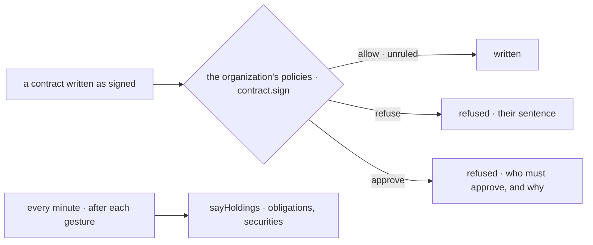

# Spec 003 — Kete Commitments on the living model

Step **A5** of Kete's release (the doctrine's `FEUILLE_DE_ROUTE.md`; kete-core spec 114; Kete
Enterprise spec 091). The author's go came on 2026-10-17 (« Passe à A5 : les quatre apps du centre
sur le modèle unifié »).

## Why

A contract's obligations and its retentions waited in Kete Commitments alone: never in « Pour
moi », never relayed when who keeps the contract is away. A policy written at the center (« un
agent ne signe jamais », « au-delà de 5 000 000 F, le DG approuve ») did not decide a signed
contract written here.

## Requirements

- **FR-001 — A signature through the policies.** A contract written with its signature day is a
  `contract.sign` on its project, else its party, else its subject (`prd_kete_commitments.contract`),
  with its amount (zero when it has none). `refuse` stops it with the policies' sentences;
  `approve` stops it saying who must approve, by relation or role, and why; `allow` or `unruled`
  writes it. A contract without its signature day commits nothing: the policies are not asked.
- **FR-002 — What Kete Commitments holds**, said to the center after each gesture and every
  minute, held by who wrote the contract: what we owe (due on its day); what the other party owes
  (waiting on it when the center knows it); a retention or a bond to recover (due on the day it may
  be claimed back). Each on its project when it has one, with its address here.
- Every word from the catalogs.

## Proof

- Tests: a signed contract stopped by a policy asking an approval, refused by another with its
  sentence, written unsigned without asking; obligations and securities said as holdings of who
  wrote the contract, with their address.

## Not done here

An approval opened as a card at the center; the contract's own keeper beyond who wrote it.
